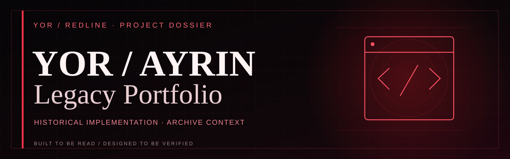
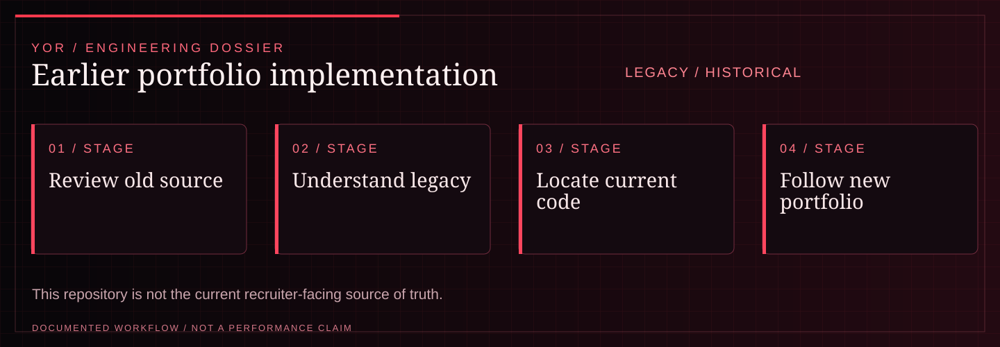

<!-- YOR REDLINE / README COVER V1 -->
<div align="center">

<picture><source media="(max-width: 600px)" srcset="docs/yor-redline-cover-mobile.svg"/></picture>

<sub><strong>YOR / PROJECT DOSSIER</strong> · <a href="https://github.com/yorayriniwnl">GitHub</a> · <a href="https://yorayriniwnl.in">Portfolio</a></sub>

</div>
<!-- END YOR REDLINE -->

# Yor / Ayrin — Portfolio

> **Legacy implementation.** The current recruiter-facing portfolio source is [Portfolio-Ayush-Roy](https://github.com/yorayriniwnl/Portfolio-Ayush-Roy), deployed at [yorayriniwnl.in](https://yorayriniwnl.in). This repository is retained for historical implementation context.

This repository contains the former focused portfolio implementation for Ayush Roy and is retained only for historical context.

Broader experiments and non-recruiter work now live behind the current portfolio’s [Lab](https://yorayriniwnl.in/lab) surface. This legacy repository is not the source of the current public site.

<!-- YOR REDLINE / EXPERIENCE V2 -->

<a id="system-map"></a>
## System map

<div align="center"><picture><source media="(max-width: 600px)" srcset="docs/yor-redline-system-mobile.svg"/></picture></div>

| Project signal | Documented scope |
| :--- | :--- |
| **Current maturity** | LEGACY / HISTORICAL |
| **Technical focus** | Previous portfolio source kept as implementation history, with links to the current canonical portfolio. |
| **Evidence boundary** | This repository is not the current recruiter-facing source of truth. |

**Navigate:** [Run locally](#run-locally) · [Verify](#verify) · [Stack](#stack)

<!-- END YOR REDLINE / EXPERIENCE V2 -->

## Run locally

```bash
npm install
npm run dev
```

## Verify

```bash
npm run build
npm run lint
npm run typecheck
```

There is intentionally no contact form, dashboard, API route, or game runtime in
this repository. Those belong to the separate hub project.

## Stack

Next.js, React, TypeScript, and CSS. The home page is intentionally the only portfolio route; supporting legacy route trees are no longer part of this product surface.